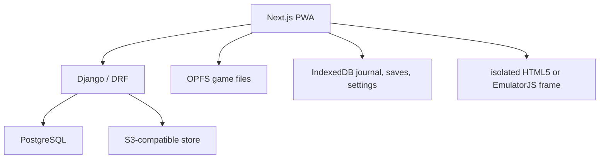

# Architecture

Django owns catalog entities, immutable core/release/asset identities, distribution evidence, publication policy and signed manifests. The importer accepts only explicit local bundle files, verifies hashes before object-store upload, and never fetches arbitrary URLs. Public API routes are read-only; Admin is authenticated and reuses the same validators.

The Next application treats the server manifest as an immutable installation plan. A dedicated worker uses a Web Lock per asset, obtains strict 206 ranges, writes bounded buffers through OPFS synchronous handles, flushes before writing the IndexedDB chunk checksum, and verifies the final streaming SHA-256 before the installation may become ready. The service worker caches only the shell and pinned runtime resources; large game files stay in OPFS rather than Cache Storage.

The player re-audits OPFS and cached core bytes before launch. HTML5 games run in a script-only opaque iframe. WASM games run in a same-origin, sandboxed frame with a small `EmulatorAdapter` bridge; the rest of the application does not reach EmulatorJS internals. Saves carry release/core/version/hash identity and are validated before replacement. Input merges keyboard, gamepad and touch sources and releases held controls on blur, visibility loss and disconnect.

Core versions and byte hashes are locked in `docs/core-package-lock.json`; runtime upgrades require a new adapter-compatible package and a fresh test run. PS1 multi-file media and PSP large-file access are not accepted until their explicit bundle adapters and tests exist.
